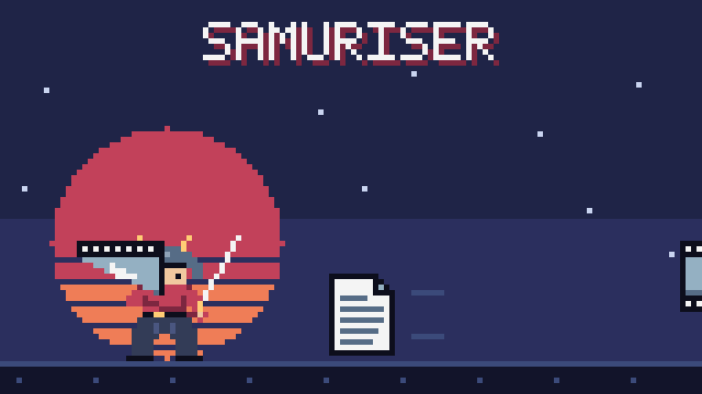

# Samuriser

**Watch a one-hour talk in about half the time.** Samuriser cuts the padding out of videos and articles and keeps the rest exactly as it was made: the original footage, in the original order, playing in YouTube's own player. It cuts like a samurai.


https://github.com/user-attachments/assets/2d928586-4033-4afd-9639-e62d2cbdbddc


*Sound on for narration. Talks shown: ["Tightening every bolt"](https://youtu.be/Yr5fPxZvhOw) by Daniel Stenberg, FOSDEM 2025, and ["Autonomous Testing and the Future of Software Development"](https://youtu.be/fFSPwJFXVlw) by Will Wilson, The Linux Foundation. Both CC BY.*

<p align="center"></p>

Some real results: a 56-minute interview came out at 24 minutes, an 18-minute talk at 9, and a 34-minute talk at 10 minutes, or 5 at the shortest setting.

It also tells you when something only repeats ideas you've already seen, so you can skip it altogether.

## How it works

1. You save a video or article, from the Chrome extension, the local site, or a YouTube playlist.
2. Claude reads the transcript, writes a summary and key ideas, and decides which parts teach nothing: intros, recaps, repetition, sponsor reads and filler.
3. The player jumps over those parts as you watch. Nothing is re-encoded, and every cut is listed with its reason, so you can restore any of them or switch back to the full video.

## Before you start

This is a personal project that runs on your own computer, not a hosted service. You need:

- **An Apple Silicon Mac.** That's where it is built and tested. On other systems, YouTube videos that have captions and articles should work, because they don't need speech-to-text on your machine, but that is untested.
- **Claude.** Either a signed-in [Claude Code](https://claude.com/claude-code) or an `ANTHROPIC_API_KEY`. Each item takes a few requests, which count against your plan or credit.
- **[uv](https://docs.astral.sh/uv/)**, and **[Node](https://nodejs.org) or [bun](https://bun.sh)**, which yt-dlp needs for YouTube.
- **`ffmpeg`**, only for videos that have to be downloaded.
- **Chrome**, for the extension. It is loaded in developer mode and isn't in the Chrome Web Store.
- Optional: [Kokoro](https://github.com/remsky/Kokoro-FastAPI) on `127.0.0.1:8880` for natural reading voices. Without it, the reader uses the browser's voices.

## What it does

- **Is it worth my time?** Compares a video or article's specific ideas with everything you've marked as seen.
- **How padded is it?** Each item gets a rough estimate of how much teaches nothing, shown as a badge. Padded items are cut harder than dense ones.
- **Shorten it.** Keeps the useful parts of a video or article at three lengths. Every length opens with one line saying what it's about and ends with a short sign-off.
- **No download for YouTube.** A YouTube video is shortened from its captions and plays shortened in YouTube's own player, on YouTube through the extension or embedded in the local site. If a video has no captions, or YouTube refuses them, only its audio is downloaded, to be transcribed on your Mac. Videos from other sites are downloaded, because there is nowhere else to play them.
- **Watch and read.** A local player jumps over cuts in videos, and a reader shows shortened articles and can read them aloud.
- **Library.** Thumbnails, full-text search, and a history across platforms.

## What it doesn't do

- **It doesn't block or remove ads.** YouTube videos play in YouTube's own player, ads included.
- **It doesn't share or re-upload anything.** Videos, transcripts and edits stay in a folder on your computer. The optional phone copy never contains video.
- **It doesn't track you.** There is no account and no telemetry. See [Privacy](#privacy) for exactly what leaves your machine.
- **It doesn't get every cut right.** The cuts are a model's judgement. If one looks wrong, restore that section or play the full video.

## Run it

```sh
uv sync
uv run samuriser
```

Then open http://127.0.0.1:8765 and paste links, one per line.

To download a video and make a file with the timer and progress bars burned in:

```sh
uv run shorten <link> --ratio 0.3
```

Downloads, transcripts and edits are stored in `runs/`, which is not committed.

## Read it on your phone

The site only runs on your Mac. To use your library when the Mac is off, it can publish a read-only copy to any S3-style storage, such as Cloudflare R2. The copy holds summaries, cut lists and thumbnails. It never holds video files: YouTube videos stream from YouTube, and downloaded videos stay on the Mac.

The copy has no login. Anyone with its address can read it, so use an address that is hard to guess, such as R2's public development URL, and don't share it.

Put these in a `.env` file in this folder:

```sh
SAMURISER_PUBLISH_BUCKET=<bucket name>
SAMURISER_PUBLISH_ENDPOINT=https://<account id>.r2.cloudflarestorage.com
SAMURISER_PUBLISH_KEY_ID=<access key id>
SAMURISER_PUBLISH_SECRET=<secret access key>
```

An article is published as its summary and key ideas, with a link to the original. To include the full text so you can read it on your phone, add `SAMURISER_PUBLISH_ARTICLE_TEXT=1`. That puts a complete copy of someone else's writing at a public address, so only do it for your own reading and keep the address to yourself.

While the site is running it republishes after every change. To publish by hand, run `uv run publish`. Then open `<public address>/index.html` on your phone.

Search, marking things as watched and changing cuts only work on the local site.

To add videos from your phone, make an unlisted YouTube playlist and add its link to `.env`:

```sh
SAMURISER_INBOX_PLAYLIST=https://www.youtube.com/playlist?list=<id>
```

While the site is running it checks the playlist every five minutes and shortens anything new, so saving a video to that playlist in the YouTube app adds it to your library. Videos saved while the Mac is off are picked up the next time the site runs.

## Chrome extension

The `extension/` folder adds Samuriser to Chrome. It needs the local site running.

- **Three-dot menu on YouTube thumbnails:** has an **Add to Samuriser** item. YouTube has no supported way to extend that menu, so expect it to need fixing when YouTube changes.
- **Right-click** any video thumbnail, link or page and choose **Add to Samuriser**. It's added and checked in the background, and the verdict appears in the library.
- **Toolbar button:** adds the page you're looking at, as you see it, which helps with sites you're logged in to. It also links to your library.
- **On a YouTube video:** one line shows whether it's added and lets you shorten it. A shortened video can then play in YouTube's own player by jumping over the cuts.

To install it, open `chrome://extensions`, turn on **Developer mode**, choose **Load unpacked** and pick the `extension` folder. After changing its files, press the reload arrow on its card there.

## Privacy

Everything is stored in `runs/` on your computer. These are the only things that leave it:

- **To the sites you save from:** requests for the page, captions and thumbnail, as any browser would make.
- **To Anthropic:** the transcript or article text, and for downloaded videos a sample of frames, so Claude can summarise and decide the cuts. Claude runs with no tools, so text inside a transcript can't make it do anything.
- **To Hugging Face:** a one-time download of the speech model, the first time something is transcribed on your Mac.
- **To your own storage:** only if you set up the phone copy described above.

The local site listens on `127.0.0.1` only, and accepts changes only from its own pages and the extension, so other websites open in your browser can't add or delete things. The extension can read YouTube pages and the local site, and nothing else unless you use its button or right-click menu on a page.

## Develop

```sh
uv run pytest
uv run ruff check .
uv run ruff format .
uv run mypy .
```

## Use and licence

This is a personal tool for getting through things you would otherwise watch or read in full. It is released under the [MIT licence](LICENSE).

Samuriser is not affiliated with or endorsed by YouTube, Google or Anthropic.

It reads videos and pages through [yt-dlp](https://github.com/yt-dlp/yt-dlp), which some sites' terms of service don't allow. You are responsible for how you use it: follow the terms of the sites you use it with, and don't share downloaded videos or copies of other people's work.
